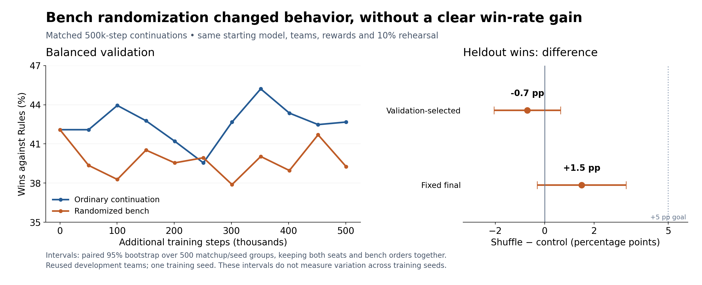

# Student play and Q&A: learning Pokémon battle decisions

Prepared for student play on October 20, 2026. Continue the targeted
[switch-practice comparison](switch-practice.md), while keeping the
completed teacher-trained agent available for students. The purpose is interactive play and
questions; the evidence below supplies concrete examples to explain decisions.

## Central question

Can a reinforcement-learning agent learn useful battle decisions, and what
prevents skills learned on simple teams from transferring to varied teams?

## What was built

- A repeatable battle environment with legal-action masks and saved PPO models.
- Fast Showdown training and an mGBA path for visible human-versus-agent play.
- Fixed evaluation schedules, both player seats, checkpoint provenance,
  all-battle decision counts, and bounded detailed traces.
- A curriculum beginning with simple move choice and a fixed mirror matchup,
  then introducing varied team compositions and moves.

## Evidence to present

| Experiment | Finding | What it supports |
|---|---|---|
| Simple move-choice task | 100% wins against the configured Rules opponent | The agent can acquire the deliberately simple skill |
| Fixed mirror task | Qualified frozen checkpoint reached 99.6% | Strong performance is possible on a narrow, repeated matchup |
| Varied-team matchup features | Best validation 27.0% control versus 42.4% with features | Explicit game-mechanic relationships improved learning in this pair |
| Matchup features, fixed final budget | Heldout 32.2% control versus 40.6% with features | Better performance on the reused development pool at equal training budget |
| Frozen replacement intervention | Final model 40.6% alone versus 45.0% with Rules replacements | Replacement decisions are one measurable remaining weakness |
| Bench-order training, validation-selected | Heldout mean 37.4% control versus 36.7% shuffled | Randomization did not improve the predeclared primary result |
| Bench-order training, fixed final | Heldout mean 40.6% control versus 42.1% shuffled | Small secondary gain; paired interval includes zero |
| Replacement-feature training, fixed final | Heldout mean 40.3% control versus 43.65% features | Useful gain on this reused pool; neither improved best validation |
| Expanded training pool, validation-selected | Heldout mean 42.55% small pool versus 39.50% expanded pool | More training-team coverage did not establish better general play |
| Rules warmup + PPO, validation-selected | 51.37% validation, 46.50% then-unseen teams, 93.7% mirror | Better than the parent; +1.70-point unseen-team advantage over matched PPO remains uncertain |

These are different tasks and comparisons; do not connect them as a single
win-rate learning curve. All percentages above are wins against Rules in the
named setup. Draws and truncated battles count as nonwins.

## One clear behavior example

The matchup input change supplies five numbers per active move: whether the
case is assessed, type effectiveness, supported immunity-adjusted effectiveness,
an immunity indicator, and Same-Type Attack Bonus. These are programmed game
mechanics supplied to the network; the agent still learns its action choices.

On the original heldout checks, the best control selected immune attacks in
773 of 8,863 assessed moves. The best matchup model selected none in 8,530.
That is a concrete behavioral improvement, beyond a small change in win rate.

The next diagnostic found another concrete pattern: the best matchup model
always chose the lowest legal replacement slot in all 3,970 eligible choices
across the tested pools and bench orders. Permuting the bench exposes why a
policy can appear competent while relying on an unhelpful positional shortcut.

## What the completed bench-order comparison showed

Both policies continued from the same validation-selected checkpoint and optimizer
with the same additional training budget. One policy encountered randomized bench
positions on the current task. Initial leads, canonical team pairings, opponent,
reward and fixed-mirror rehearsal stayed the same. Both checkpoints were selected
using validation balanced across original and reversed bench orders.

Shuffling changed slot preference but did not establish a useful win-rate
improvement. Selected-policy difference: -0.7 percentage points, paired 95%
interval -2.05 to +0.65. Fixed-final difference: +1.5 points, interval -0.30 to
+3.30. These intervals preserve both seats and both orders for each matchup/seed;
they do not quantify variation across independent training runs.

The shuffled model's selected checkpoint stayed at its initial evaluation because
later validation scores did not improve. Control reached 45.2% balanced validation
at 852,992 steps. Both final policies improved mirror wins from 45.9% to about 61%.
All 32,680 frozen battles completed without truncation; all 280,807 classified
move selections avoided a currently immune target in the audit's supported scope.

Use `figures/bench-order-result.svg` for scalable slide graphics, or the PNG.

## Limitations to say aloud

- The current comparison is still a restricted three-Pokémon task with two
  damaging moves per Pokémon. Its expanded pool has 112 non-mirror training
  teams; that does not test arbitrary movesets or competitive six-Pokémon play.
- Heldout teams were excluded from training, but their results have been reused
  during development. They are not an untouched final test.
- One matched training-seed pair does not establish reliability across seeds.
- The Rules-assisted 45.0% score belongs to a hybrid policy. It is not a score
  achieved by the learned agent alone.
- Known mechanics were engineered into the observation representation. The
  agent did not independently discover the type chart in that experiment.
- The new teacher-warmup experiment learns from Rules' suggested actions before
  reinforcement learning. Describe it as imitation plus reinforcement learning.
  Rules supplies training labels; it does not override the saved model in play.
  The completed result improved mirror play strongly; varied-team wins remain
  below 50% on the then-unseen composition pool. Those teams now become reused
  development checks for the next experiment.
- High fixed-team performance does not imply success on arbitrary six-Pokémon
  teams, unfamiliar mechanics or competitive human opponents.

## Suggested demonstration

Use the [two-choice classroom menu](../play-gui.md#classroom-two-opponents-and-a-clear-default):
**Coached AI** is the default, with **Rewards-only AI** as the single alternative.
This compares the completed teacher-training selected model with that experiment's
PPO-only best. Keep specialist models and historical checkpoints out of the
student menu. The guide includes permanent copies and the shortlist launch command.

Rehearse a saved model on two different current training teams and
explain its move choices and replacement limitations. Keep AI action sampling
off initially, as in the frozen checks. The fixed-mirror specialist can be an
optional second demonstration or recorded clip if already working; its measured
result alone is enough for the presentation. Human games are illustrative
demonstrations, not substitutes for the fixed evaluation suite.

The training runner saves selected checkpoints and their hashes. Record a
short successful startup and battle clip as a fallback to a live demonstration.
Keep the original 400k reference and all experiment results intact.

## Use the available hours

1. Start the two-job switch-practice comparison and watch its logs,
   validation and memory using the commands in its guide.
2. While it trains, play two games against the saved teacher-training selected model and verify
   startup after a GUI restart. Keep that checkpoint as the working fallback.
3. Once the runner finishes, try its validation-selected model on the same
   familiar teams. Read the result before claiming an improvement.
4. Prepare a few questions for students: why did the AI pick that move, what
   information does it receive, and why might it choose a weak replacement?

The optional fresh-team checker remains available, but running it is not a
prerequisite for continuing training or playing. Quantitative Rules results
and human demonstration games answer different questions.

## Questions to explore during play

1. **Goal and interface:** learn legal battle decisions and show the actual game.
2. **Controlled starting tasks:** simple move choice and fixed mirror success.
3. **Transfer problem:** success on fixed teams did not carry over to varied teams.
4. **Representation experiment:** explicit matchup features removed observed
   immunity mistakes and improved this paired comparison.
5. **Remaining weakness:** forced replacements favored party slots. A frozen
   Rules intervention measured a potential benefit, but bench shuffling alone
   did not give a clear learned-policy gain.
6. **Try the agent:** predict its action, play a response, and inspect a forced
   replacement. Explain the shared replacement scorer, its measured limits,
   and why the next run refreshes those examples with more attention to rare
   voluntary-switch decisions before reward learning.

The contribution is a working agent plus evidence explaining what it learned,
what failed to transfer, and which controlled interventions helped. A negative
bench-order result still narrows the next engineering question.
